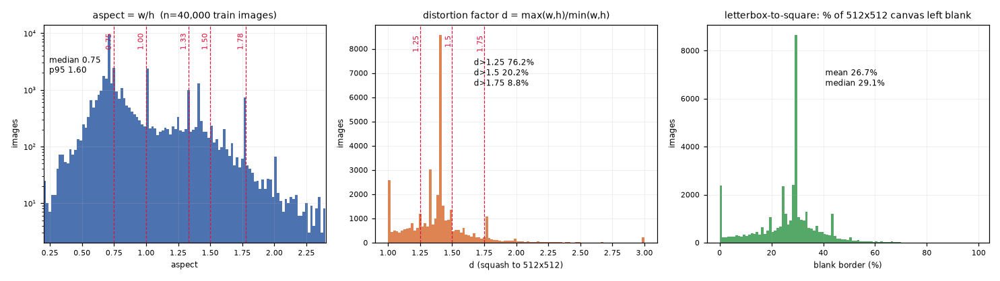

# True aspect-ratio distribution

40000 train images. Left panel is log-y (the 0.75 and 1.00 spikes are 8.6% and 6.5% of the corpus); clipped to 0.2–2.4 for readability (full range 0.062–6.70).

## Percentiles of `aspect = w/h`

| | min | p1 | p5 | p25 | p50 | p75 | p95 | p99 | max |
|---|---|---|---|---|---|---|---|---|---|
| train (40k) | 0.0618 | 0.4089 | 0.5658 | 0.7064 | 0.7500 | 1.0000 | 1.6000 | 1.9328 | 6.7047 |
| train (10k = training set) | 0.0510 | 0.4125 | 0.5658 | 0.7064 | 0.7500 | 1.0000 | 1.5984 | 1.9047 | 3.1741 |
| test (1k = eval set) | 0.3294 | 0.4395 | 0.5638 | 0.7067 | 0.7500 | 1.0113 | 1.6300 | 1.8221 | 2.4000 |

p50 = 0.750 and p75 = 1.000 are genuine corpus spikes (3:4 portraits, square originals), not interpolation artifacts.

## Deviation from square, `|aspect − 1|`

| bucket | train 40k | train 10k | test 1k |
|---|---|---|---|
| < 0.02 (roughly square) | 6.46% | 6.21% | 6.60% |
| 0.02 – 0.10 | 5.08% | 5.03% | 5.50% |
| 0.10 – 0.25 | 19.96% | 20.35% | 17.30% |
| 0.25 – 0.50 | 59.37% | 59.45% | 60.50% |
| > 0.50 | 9.12% | 8.96% | 10.10% |

## Named aspects (within ±0.02)

| aspect | train 40k | train 10k | test 1k |
|---|---|---|---|
| 1.00 square | 6.46% | 6.21% | 6.60% |
| 1.33 (4:3) | 2.91% | 2.96% | 3.40% |
| 1.50 (3:2) | 0.93% | 1.00% | 0.80% |
| 1.78 (16:9) | 1.95% | 2.01% | 1.40% |
| 0.75 (3:4) | 8.79% | 8.62% | 7.90% |
| 0.56 (9:16) | 2.53% | 2.49% | 2.70% |
| portrait (aspect < 1) | 70.37% | 70.70% | 69.30% |
| landscape (aspect > 1) | 24.21% | 24.04% | 25.80% |
| exactly square | 5.42% | 5.26% | 4.90% |

Only 23.6% sit near a standard aspect (six buckets, mutually exclusive). The distribution is a broad ridge — 4067 distinct aspect values in 40000 images — with spikes at 3:4, square, and odd reduced ratios 128:181 (0.707, from `640×905`) and 80:113 (0.708, from `640×904`).

## Distortion factor `d = max(w,h)/min(w,h)` for a 512×512 squash

| | p1 | p5 | p25 | p50 | p75 | p95 | p99 | max |
|---|---|---|---|---|---|---|---|---|
| train 40k | 1.000 | 1.000 | 1.2672 | 1.4109 | 1.4703 | 1.8172 | 2.5688 | 16.171 |
| train 10k | 1.000 | 1.000 | 1.2688 | 1.4109 | 1.4672 | 1.8141 | 2.5126 | 19.623 |
| test 1k | 1.000 | 1.0045 | 1.2797 | 1.4109 | 1.4812 | 1.8016 | 2.3516 | 3.036 |

| threshold | train 40k | train 10k | test 1k |
|---|---|---|---|
| `d > 1.25` | 76.23% | 76.26% | 77.20% |
| `d > 1.5` | 20.24% | 19.96% (1996 images) | 22.30% (223) |
| `d > 1.75` | 8.75% | 8.62% (862) | 8.60% (86) |
| `d > 2.0` | 2.85% | 2.88% (288) | 2.90% (29) |
| `d > 3.0` | 0.46% | 0.42% (42) | 0.30% |
| `d > 2.5` | 1.09% | 1.03% (103) | 0.80% (8) |

Worst `d` in the 40k sample: `509×8231` (d = 16.2, shard 00202); in the 10000 training images `462×9066` (d = 19.6, shard 00212); widest `4291×640` (d = 6.7, shard 00209). 0.89% of images have aspect < 0.4 (tall strips); 0.19% have aspect > 2.5.

## What letterboxing to a square would waste

`1 − (w·h)/max(w,h)²` = fraction of a 512×512 canvas that would be blank border:

| | mean | p50 | p75 | p95 | p99 | max |
|---|---|---|---|---|---|---|
| train 40k | 26.65% | 29.13% | 31.99% | 44.97% | 61.07% | 93.82% |
| train 10k | 26.65% | 29.13% | 31.84% | 44.88% | 60.20% | 94.90% |
| test 1k | 26.78% | 29.13% | 32.49% | 44.49% | 57.48% | 67.06% |

## Actual scale factors applied (`512/w`, `512/h`)

| | p5 | p50 | p95 |
|---|---|---|---|
| horizontal `512/w` | 0.516 | 0.800 | 0.931 |
| vertical `512/h` | 0.466 | 0.609 | 0.853 |

Anisotropy of the median image: `0.800 / 0.609 = 1.31×` from per-axis medians, `0.800 / 0.600 = 1.33×` for the median-aspect image (`640×853`), `0.800 / 0.566 = 1.41×` for the most common exact size (`640×905`, 5.5%). A source circle becomes an ellipse 31–41% wider than tall. `512/w > 1` (horizontal upscale) for 3.98% of images, `512/h > 1` for 2.03%; largest upscale 5.12× (a 100 px image).
