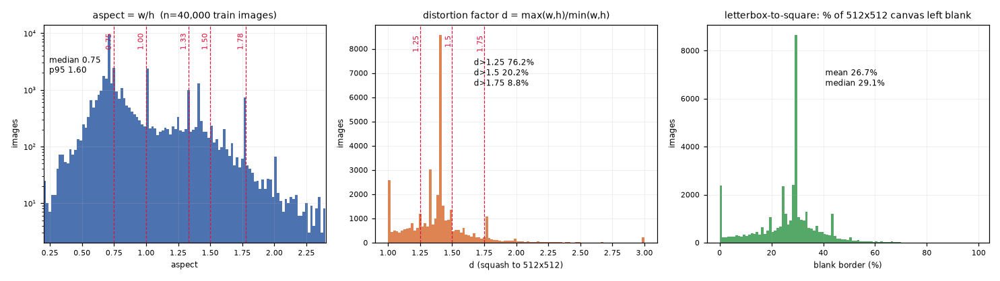

# Dataset geometry audit — `wdtaggerv4` (w640 webdataset)

Scope: are there geometric-tampering traces (stretching, padding, bar-removal) in the source
images, and what does the true aspect-ratio distribution look like before our pipeline squashes
it to 512×512.

Constraint compliance: CPU + disk only, no GPU, no writes outside `scratch/sophie/`, nothing
under `wdtag/`, `configs/`, `runs/` modified, and `I:\.cache\wd-tagger-trainer` was **not read
at all** (not even read-only). 55,000 image reads in total (51,000 header-only + 4,000 full
decodes), every one contiguous from a shard start.

| sample | what it is | n |
|---|---|---|
| `train_broad` | 400 consecutive images from each of 100 train shards (shards spread evenly over the 213 sorted tars) | 40,000 |
| `train_cache` | the *exact* 10,000 images the trainer sees, in `CacheDataset` index order (replicates `build_plan("train")` + cache builder) | 10,000 |
| `test_cache` | the *exact* 1,000 test images in prediction order (replicates `build_plan("test")`, `per_pos = 84`, truncated at 1000) | 1,000 |
| `bar_pixels` | 4,000 decoded images (10 shards × 400) for a direct pixel check of flat border strips | 4,000 |

Verification of the replication: all 800 `debugpics/manifest.json` entries across the 8 real
training runs (`runs/*/debugpics/manifest.json`, each a random sample of the live train cache)
are present in my replicated `train_cache` rows — 800/800 (`key`, `tar`) pairs found, 0 missing.
Metadata `width`/`height` equals the PIL header size in 51,000/51,000 images. All images are
WEBP.

---

## Headline

1. **There is no annotation for stretch / aspect distortion anywhere in the vocabulary.** All
   12,476 tag names were scanned (the dataset's own `tags.csv`): the strings `aspect`,
   `disproportion`, `squished`, `squashed`, `elongat`, `fattened`, `messed up` appear in **zero**
   tag names. Tag-based detection of stretching is impossible on this dataset; only geometry can
   find it.
2. **The images are not 640 wide.** `w640` means *min side* ≤ 640: `min(w,h) == 640` for 85.1% of
   images and `< 640` for 14.9%; **no** image has `min(w,h) > 640`. Width is exactly 640 for only
   65.2% (`h == 640` for 24.9%). The upstream resize preserved aspect — it neither stretched nor
   padded.
3. **The median image is portrait 3:4.** aspect (w/h) p50 = **0.750**, p95 = **1.60**; 70.4%
   portrait, 24.2% landscape, 5.4% square. Only 6.5% are within ±2% of square.
4. **Squash to 512×512 distorts by a median factor of 1.41** (p95 **1.82**), i.e. the median
   training image's horizontal and vertical scales differ by 41%. **19.96% of the 10,000 training
   images (1,996) are distorted by more than 1.5×**, 8.62% by >1.75×, 2.88% by >2×.
5. **Real padding does exist, but it is baked into the source art, not added by us**:
   `letterboxed` 0.67%, `pillarboxed` 0.08%, `border` 1.89% / `white_border` 1.12%. A pixel check
   confirms it — images tagged `letterboxed` are ~4× more likely than the base rate to show
   symmetric flat strips on opposite edges (47.4% vs 12.0%). Nothing in the pipeline *removes*
   bars; squash shrinks them but keeps them as bars.

---

## 1. What the images actually are

| quantity | value |
|---|---|
| `w == 640` | 65.23% |
| `w < 640` | 11.44% |
| `w > 640` | 23.33% |
| `h == 640` | 24.92% |
| `min(w,h) == 640` (downscaled by upstream) | 85.06% |
| `min(w,h) < 640` (native small, never upscaled) | 14.94% |
| `min(w,h) > 640` | **0%** |
| width p1 / p50 / p99 / max | 416 / 640 / 1,183 / 4,291 px |
| height p1 / p50 / p99 / max | 478 / 841 / 1,418 / 8,231 px |
| height where `w == 640` (n=26,092): p5/p50/p95 | 640 / 903 / 1137 px |
| distinct widths / heights / aspect values (40k sample) | 1,088 / 1,316 / 4,067 |

Top exact sizes (40k sample): `640×905` 2,195 (5.5%), `640×640` 1,901 (4.8%), `640×904` 1,487,
`640×903` 1,261, `640×853` 1,216, `853×640` 516, `1137×640` 508.

---

## 2. Task A — prowling the annotations

Method. Two independent measurements:

* **Vocabulary scan** — the dataset ships `tags.csv` (all 12,476 labels with corpus-wide counts
  over 5,914,596 images). Any pattern that is absent here is absent from the dataset's *entire*
  annotation scheme, so a zero there is a strong negative, not a sampling artifact.
* **Sample scan** — 40,000 contiguous train images. Match classes:
  `exact` = the whole tag equals the pattern; `token` = the pattern appears as whole
  underscore-separated token(s) inside the tag (e.g. `white_border` for `bar`); `sub` = the
  pattern appears anywhere as a substring (noise-prone: `clothing` contains `thin`).
  Prevalence is *images* (multi-label: one image can hit several tags) out of 40,000.

### 2a. Stretch / distortion patterns

| pattern | class | matched tag(s) | corpus count | images / 40k | prevalence |
|---|---|---|---|---|---|
| `deformed` | exact | `deformed` | 5,834 | 28 | **0.070%** |
| `bad proportions` | exact | `bad_proportions` | 2,250 | 6 | **0.015%** |
| `bad anatomy` | exact | `bad_anatomy` | 16,592 | 49 | **0.122%** |
| `distort` | sub | `distortion` | 1,055 | 8 | **0.020%** |
| `stretch` | token | `cross-body_stretch` | 768 | 3 | 0.008% |
| `stretch` | sub | `outstretched_arms` 71,812 · `outstretched_arm` 70,317 · `outstretched_hand` 25,745 · `stretching` 17,214 · `outstretched_leg` 1,786 | — | 820 | 2.050% |
| `thin` | sub | `clothing_cutout` 697 · `clothing_aside` 165 · `heavy_breathing` 163 · `shrug_(clothing)` 116 · `shared_bathing` 85 · …17 tags | — | 1,364 | 3.410% |

Reading: the 2.05% "stretch" hit rate is entirely **pose** (`outstretched_arms` is a pose tag,
`stretching` is a stretching-body pose), and the 3.41% "thin" hit rate is entirely **substring
noise inside unrelated words** (`clothing`, `breathing`, `bathing`, `thinking`). Neither is
evidence of image distortion. The only tags that describe *deformed output* rather than *poses*
are `deformed` (0.07%), `bad_proportions` (0.015%), `bad_anatomy` (0.12%) and `distortion`
(0.02%) — and none of them means "stretched by the pipeline"; they are ordinary art-criticism
tags used at well below 1% each.

### 2b. Padding / letterbox / bar patterns

| pattern | class | matched tag(s) | corpus count | images / 40k | prevalence |
|---|---|---|---|---|---|
| `letterbox` | sub | **`letterboxed`** | 59,279 (1.00%) | 268 | **0.670%** |
| `pillarbox` | sub | **`pillarboxed`** | 6,152 (0.10%) | 33 | **0.083%** |
| `border` | exact | **`border`** | 155,761 (2.63%) | 757 | **1.893%** |
| `border` | token | `white_border` | 99,060 (1.68%) | 449 | **1.123%** |
| `border` | token | `outside_border` | 61,780 (1.05%) | 315 | 0.788% |
| `border` | token | `black_border` 17,664 · `inset_border` 2,605 · `ornate_border` 2,232 · `grey_border` 3,795 · `pink_border` 2,668 · +5 | — | 83 / 12 / 16 / 27 / 8 (per tag; nearly all co-occur with `border`) | ≤0.21% each |
| `border` | any | any `*border` tag (848 distinct images; only 1 of them lacks one of `border`/`white_border`/`outside_border`) | — | 848 | **2.120%** |
| `panel` | sub | `borderless_panels` | 1,294 | 3 | 0.008% |
| `padding` | token | `breast_padding` (garment, not image) | 1,373 | 11 | 0.028% |
| `white background` | exact | `white_background` | 1,650,067 (27.9%) | 7,000 | 17.500% |
| `simple background` | exact | `simple_background` | 1,993,448 (33.7%) | 8,461 | 21.152% |
| `comic` | exact | `comic` | 572,373 (9.68%) | 2,302 | 5.755% |
| `comic` | token | `silent_comic` (87) · `segmented_comic` (6) · `right-to-left_comic` (6) | — | 87 / 6 / 6 | 0.218% / 0.015% / 0.015% |
| `comic` | any | any `*comic` tag | — | 2,308 | 5.770% |
| `4koma` | exact | `4koma` (+`multiple_4koma` 26, `square_4koma` 11) | 102,478 (1.73%) | 417 (454 family) | 1.043% |
| `2koma` | exact | `2koma` | 31,895 (0.54%) | 137 | 0.343% |
| `multiple views` | exact | `multiple_views` | 183,377 (3.10%) | 868 | 2.170% |
| `split screen` | exact | `split_screen` | 1,958 (0.03%) | 12 | 0.030% |
| `out of frame` | exact | `out_of_frame` | 35,274 (0.60%) | 168 | 0.420% |
| `out of frame` | token | `feet_out_of_frame` 723 · `foot_out_of_frame` 157 · `head_out_of_frame` 131 · `knees_out_of_frame` 5 | — | 996 | 2.490% |
| `cropped` | token | `cropped_jacket` 254 · `cropped_legs` 227 · `cropped_torso` 207 · `cropped_shirt` 123 · +6 | — | 865 | 2.163% |
| `two side` | token | `two_side_up` (hairstyle — noise) | — | 770 | 1.925% |
| `manga` | token | `manga_cover` 15 · `manga_(object)` 14 · `left-to-right_manga` 10 | — | 39 | 0.098% |

(`white_background` / `simple_background` are listed only for completeness: they are **not**
bar evidence, exactly as cautioned — a white *canvas* is not a white *bar*.)

### 2c. The user's specific terms that do NOT exist at all

These patterns return **zero hits in the sample and zero hits in the entire 12,476-tag
vocabulary** — i.e. the string occurs in no tag name whatsoever:

| user term | in sample | in vocabulary |
|---|---|---|
| `aspect ratio` | 0 | 0 |
| `bad aspect ratio` | 0 | 0 |
| `disproportion` | 0 | 0 |
| `white bar` | 0 | 0 |
| `side panel` | 0 | 0 |
| `white background panel` | 0 | 0 |
| `squashed` | 0 | 0 |
| `squished` | 0 | 0 |
| `elongat…` | 0 | 0 |
| `fattened` | 0 | 0 |
| `messed up` | 0 | 0 |
| `side by side` | 0 | 0 |

The nearest real tags are `letterboxed` / `pillarboxed` (exact intent) and `border` /
`white_border` (frame present), which exist and are measurable.

### 2d. Direct pixel check — do the bars actually exist?

Decoded 4,000 train images and measured flat strips that match the edge-row colour
(tol ≤ 6/255 per channel), then required the strip to be **symmetric** (equal on both opposite
sides within 2%), which is the signature of real padding rather than a plain background.

| measurement | top+bottom | left+right |
|---|---|---|
| flat strip ≥ 5 px | 15.90% | 21.52% |
| flat strip ≥ 2% of the dimension | 8.97% | 16.12% |
| **symmetric** flat strip ≥ 2% | **5.55%** | **8.65%** |
| **symmetric** flat strip ≥ 2%, strip is white (>235) | **4.08%** | **7.10%** |
| symmetric flat strip ≥ 5% | 1.50% | 4.25% |

Cross-tab against the dataset's own tags (base rate for "symmetric strip ≥2%": 11.97%):

| tag | n in 4k | has flat strip | has **symmetric** strip | vs base |
|---|---|---|---|---|
| `letterboxed` | 19 | 52.6% | **47.4%** | 4.0× |
| `pillarboxed` | 1 | 100% | 100% | — |
| `white_border` | 43 | 53.5% | **41.9%** | 3.5× |
| `border` | 76 | 38.2% | 31.6% | 2.6× |
| `4koma` | 25 | 56.0% | 56.0% | 4.7× |
| `white_background` | 718 | 38.9% | 20.5% | 1.7× |
| `simple_background` | 855 | 37.0% | 19.4% | 1.6× |

Interpretation, bounded by the data: padding bars are **real** (the `letterboxed` tag is
enriched 4× over base rate at detecting them, so both the tag and the detector are meaningful).
Reading the two measurements together: **1.87% of images (746/40,000) carry a
`letterboxed` | `pillarboxed` | `white_border` tag**, 2.12% carry some `*border` tag, and
**11.97% of images have a symmetric flat strip ≥2% of at least one dimension** by pixels —
5.55% on the top/bottom axis and 8.65% on the left/right axis, of which 4.08% / 7.10% are white.
A flat background cannot be distinguished from a bar by pixels alone, which is why
`white_background` sits at only 1.7× base rate — that is the false-positive floor of this method,
not tampering. **This padding is present in the source artwork** (scanlation borders, screenshot
bars, framed illustrations); the upstream w640 resize only rescales, so it neither adds nor
removes it.

---

## 3. Task B — the true aspect-ratio distribution



Figure: 40,000 train images. Left panel is log-y (the 0.75 and 1.00 spikes are 8.6% and 6.5% of
the corpus); clipped to 0.2–2.4 for readability (full range 0.062–6.70).

### 3a. Percentiles of `aspect = w/h`

| | min | p1 | p5 | p25 | p50 | p75 | p95 | p99 | max |
|---|---|---|---|---|---|---|---|---|---|
| train (40k) | 0.0618 | 0.4089 | 0.5658 | 0.7064 | **0.7500** | 1.0000 | **1.6000** | 1.9328 | 6.7047 |
| train (10k = training set) | 0.0510 | 0.4125 | 0.5658 | 0.7064 | **0.7500** | 1.0000 | 1.5984 | 1.9047 | 3.1741 |
| test (1k = eval set) | 0.3294 | 0.4395 | 0.5638 | 0.7067 | **0.7500** | 1.0113 | 1.6300 | 1.8221 | 2.4000 |

The p50 = 0.750 and p75 = 1.000 values are genuine corpus spikes (3:4 portraits and square
originals), not interpolation artifacts.

### 3b. Deviation from square, `|aspect − 1|`

| bucket | train 40k | train 10k | test 1k |
|---|---|---|---|
| < 0.02 (roughly square) | 6.46% | 6.21% | 6.60% |
| 0.02 – 0.10 | 5.08% | 5.03% | 5.50% |
| 0.10 – 0.25 | 19.96% | 20.35% | 17.30% |
| 0.25 – 0.50 | 59.37% | 59.45% | 60.50% |
| > 0.50 | 9.12% | 8.96% | 10.10% |

### 3c. Named aspects (within ±0.02 of the target)

| aspect | train 40k | train 10k | test 1k |
|---|---|---|---|
| 1.00 square | 6.46% | 6.21% | 6.60% |
| 1.33 (4:3) | 2.91% | 2.96% | 3.40% |
| 1.50 (3:2) | 0.93% | 1.00% | 0.80% |
| 1.78 (16:9) | 1.95% | 2.01% | 1.40% |
| 0.75 (3:4) | 8.79% | 8.62% | 7.90% |
| 0.56 (9:16) | 2.53% | 2.49% | 2.70% |
| portrait (aspect < 1) | **70.37%** | 70.70% | 69.30% |
| landscape (aspect > 1) | 24.21% | 24.04% | 25.80% |
| exactly square | 5.42% | 5.26% | 4.90% |

Only **23.6%** of images (summed over the six buckets below, which are mutually exclusive) sit
near a "standard" aspect. The distribution is a broad ridge rather than a handful of discrete
ratios — 4,067 distinct aspect values in 40,000 images — with spikes at 3:4, square, and at the
odd reduced ratios 128:181 (0.707, from `640×905`) and 80:113 (0.708, from `640×904`).

### 3d. Distortion factor `d = max(w,h)/min(w,h)` for a 512×512 squash

| | p1 | p5 | p25 | p50 | p75 | p95 | p99 | max |
|---|---|---|---|---|---|---|---|---|
| train 40k | 1.000 | 1.000 | 1.2672 | **1.4109** | 1.4703 | **1.8172** | 2.5688 | 16.171 |
| train 10k | 1.000 | 1.000 | 1.2688 | **1.4109** | 1.4672 | 1.8141 | 2.5126 | 19.623 |
| test 1k | 1.000 | 1.0045 | 1.2797 | **1.4109** | 1.4812 | 1.8016 | 2.3516 | 3.036 |

| threshold | train 40k | train 10k | test 1k |
|---|---|---|---|
| `d > 1.25` | 76.23% | 76.26% | 77.20% |
| `d > 1.5` | **20.24%** | **19.96%** (1,996 images) | **22.30%** (223) |
| `d > 1.75` | 8.75% | 8.62% (862) | 8.60% (86) |
| `d > 2.0` | 2.85% | 2.88% (288) | 2.90% (29) |
| `d > 3.0` | 0.46% | 0.42% (42) | 0.30% |
| `d > 2.5` | 1.09% | 1.03% (103) | 0.80% (8) |

Extremes: worst `d` in the 40k sample is `509×8231` (d = 16.2, shard 00202) and in the 10,000
training images `462×9066` (d = 19.6, shard 00212); the widest is `4291×640` (d = 6.7, shard
00209). 0.89% of images have aspect < 0.4 (very tall strips); 0.19% have aspect > 2.5.

### 3e. What letterboxing to a square would waste

`1 − (w·h)/max(w,h)²` = fraction of the 512×512 canvas that would be blank border:

| | mean | p50 | p75 | p95 | p99 | max |
|---|---|---|---|---|---|---|
| train 40k | **26.65%** | 29.13% | 31.99% | 44.97% | 61.07% | 93.82% |
| train 10k | 26.65% | 29.13% | 31.84% | 44.88% | 60.20% | 94.90% |
| test 1k | 26.78% | 29.13% | 32.49% | 44.49% | 57.48% | 67.06% |

### 3f. The actual scale factors applied (`512/w`, `512/h`)

| | p5 | p50 | p95 |
|---|---|---|---|
| horizontal `512/w` | 0.516 | 0.800 | 0.931 |
| vertical `512/h` | 0.466 | 0.609 | 0.853 |

Anisotropy of the median image: `0.800 / 0.609 = 1.31×` if you take the median of each axis's
scale, or `0.800 / 0.600 = 1.33×` for the median-aspect image (`640×853`), or `0.800 / 0.566 =
1.41×` for the single most common exact size (`640×905`, 5.5% of the corpus). All three say the
same thing: a circle in the source becomes an ellipse 31–41% wider than tall in the 512² tensor.
`512/w > 1` (horizontal **upscale**) for 3.98% of images, `512/h > 1` for 2.03%; the largest
upscale is 5.12× (a 100 px image).

---

## 4. Task C — joinable tables

| file | rows (excl. header) | order | columns |
|---|---|---|---|
| `scratch/sophie/test_aspect.csv` | **1,000** | `CacheDataset` index order = prediction order | `row,w,h,aspect,key,shard` |
| `scratch/sophie/train_sample_aspect.csv` | **10,000** | same, for the training set the trainer sees | `row,w,h,aspect,key,shard` |
| `scratch/sophie/train_broad_aspect.csv` | 40,000 | my broad sample index | `row,w,h,aspect,key,shard` |

Layout (matches `build_plan` exactly): test = 84 consecutive images from each of `00001.tar`
… `00011.tar` (rows 0–923), then 76 from `00012.tar` (rows 924–999); train = 47 consecutive
images from each of the 213 train tars (rows 0–9963), then 36 from `00213.tar` (rows 9964–9999).
`row` equals the 0-based line index in every file; all rows are contiguous per shard; 0 duplicate
keys.

`row` for `test_aspect.csv` is the same index `wdtag/infer.py:predict_probs` writes into
`test_probs.npy` (it iterates `range(0, n, batch_size)` over `CacheDataset.index`, which is
shard-major — shard 0 rows 0…624, shard 1 rows 0…374, …), so `test_probs.npy[i]` ↔
`test_aspect.csv` row `i`. The order was not read back from `I:\.cache` (the brief forbade
touching it); it is derived from the same code path the cache builder uses, and that derivation
is corroborated at 800/800 images against the real train cache via the run manifests.

---

## 5. What this means for training on squashed 512×512

1. **Every image is used, but the median one is stretched 31–41%.** Median source is
   `640×841–853`; squashing to 512² applies 0.80× horizontally and 0.61× vertically. The network
   is therefore shown anime faces and bodies that are systematically ~30–40% wider than they are
   in the source art. Only 5.3% of the 10,000-image training set is `d = 1.000` (square, no
   distortion at all); 76.3% is distorted by more than 1.25×.
2. **The tail is worse than the median.** 1,996/10,000 training images (19.96%) are distorted
   by >1.5×, 862 (8.62%) by >1.75×, 288 (2.88%) by >2×, and 42 (0.42%) by >3× — the worst case in
   the 10k set is `462×9066` → d = 19.6, where the vertical scale is 20× the horizontal one.
   Those images contribute "impossible anatomy" gradients that no label contradicts.
3. **It is a consistent bias, not a train/test shift.** The test set has the same geometry
   (median 0.750 vs 0.750; `d > 1.5` 22.30% vs 19.96%; p95 aspect 1.63 vs 1.60), and the cache
   builder applies the identical squash to both. So there is no *mismatch* between train and eval
   geometry: the model learns shape in warped space and is scored in the same warped space.
4. **Squash buys short-side resolution and pays for it in anisotropy.** For the 85% of images
   whose min side is exactly 640, squash maps the short side to 512 at 0.8× and the long side at
   `512/h`. Letterboxing to a square would instead scale *both* axes by `512/max(w,h)` — for the
   median `640×853` that is 0.6×, so the short side would occupy only 384 px. Squash therefore
   keeps ~33% more linear resolution on the short side (512 vs 384) and pays 1.33× anisotropy;
   the alternative keeps shape and pays **26.7% blank canvas on average** (median 29.1%, p95
   45.0%). Neither is free — the numbers above quantify both sides of that trade.
5. **Image sizes span 0.06–6.70 in aspect and 100–8,231 px in height.** 14.9% of images are
   native-small (`min side < 640`) and 3.98% get *upscaled* horizontally by the squash (up to
   5.12×), so a slice of the training set is low-resolution and interpolated — the squash adds
   blur on top of distortion for those.
6. **Annotations cannot police any of this.** Because no tag describes stretch/aspect
   (`aspect`, `disproportion`, `squished`, … all absent from the vocabulary), the label set gives
   the model no signal about geometry, and a geometry audit cannot be done through tags — which
   is why the CSV of true `w,h` per row exists. The only geometry-adjacent labels are
   `letterboxed` (0.67%), `pillarboxed` (0.08%) and `border`/`white_border` (1.89%/1.12%): a
   model can learn those as *appearance* tags, and they survive the squash (bars stay bars, just
   squashed). Nothing in this pipeline removes bars, so there is no bar-removal to detect — the
   only "padding" present is inherited from the source art at roughly 1–2% prevalence.

---

## 6. Exact commands

```powershell
$env:PYTHONPATH="C:\Users\kerok\apps\wd-tagger-trainer"

# recon: meta keys, formats, one-shard timing (writes nothing)
C:\Python314\python.exe scratch\sophie\geom_recon.py

# stage 1 — contiguous sampling -> geom_{train_cache,train_broad,test_cache}.jsonl
C:\Python314\python.exe scratch\sophie\geom_sample.py

# stage 2 — tag forensics + aspect stats + CSVs -> geom_stats.json, *_aspect.csv
C:\Python314\python.exe scratch\sophie\geom_analyze.py

# stage 2b — size-rule details + pixel bar check on 4,000 decoded images
C:\Python314\python.exe scratch\sophie\geom_extra.py

# supporting: exact percentile dumps / corpus tag counts, sampling verification, figure
C:\Python314\python.exe scratch\sophie\geom_numbers.py
C:\Python314\python.exe scratch\sophie\geom_verify.py
C:\Python314\python.exe scratch\sophie\geom_fig.py
```

Sampling is always `_read_samples(tar, start_frac, n)` — `tarfile` iteration from byte 0, so
every read is contiguous and no random seeks into the tars are performed. Headers are read with
`PIL.Image.open(io.BytesIO(blob)).size` only (no full decode) except in `geom_extra.py`, where
4,000 images are decoded for the pixel bar check.
